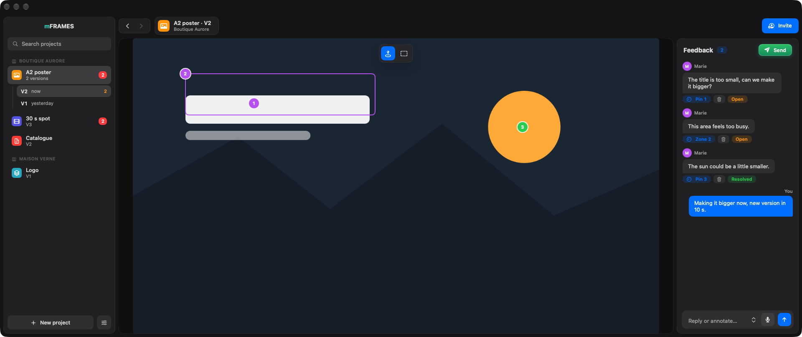

# mFRAMES

## About

**mFRAMES** is a native macOS app for live review and annotation between a provider and their client: video, photos, PDF and layouts, design mockups. Both sides work together in real time over an end-to-end encrypted direct connection, with no hosting of the media on a third-party platform. The client needs nothing installed: a link opens the review in any browser.

- Authors: Starbudweiser & Claude Code (Anthropic) — MIT License, © 2026 Starbudweiser.
- Provided as is, without warranty. Part of the **DESKTOP MAC TOOLKIT**.
- In the app: menu **mFRAMES ▸ About mFRAMES**.

## Fonctions (1.0)

- **Session en direct** : le prestataire invite son client (code, QR code ou lien) ; annotations, réponses et position de lecture (« Suivez-moi ») circulent en pair-à-pair, chiffrées de bout en bout (AES-GCM, clé dérivée du secret de l'invitation, compteur anti-rejeu).
- **Client sans installation** : un serveur web intégré sert la page du client ; le secret reste dans le fragment du lien (jamais envoyé au serveur), le chiffrement est le même (WebCrypto, ou JavaScript pur sur une page http du réseau local). Une app cliente peut aussi ouvrir l'invitation (`mframes://…`).
- **Médias** : vidéo (proxy H.264 720p), images (JPEG ≤ 2560 px), PDF (pages), PSD (aperçu composite) et AI (PDF) ; les proxys passent par blocs de 256 Ko reprenables, avec vérification d'empreinte SHA-256. Les originaux ne quittent jamais le Mac du prestataire.
- **Copie locale du client** : le client garde le proxy complet (plafond d'espace réglable, effaçable) et continue sa review hors ligne ; tout se synchronise au retour.
- **Annotations** : épingles et zones, images de la vidéo, pages de PDF, réponses en bulles, statut ouvert / résolu.
- **Coupures** : journal local chiffré (SQLite, clé dans le Trousseau) ; chacun écrit d'abord chez lui, le client se reconnecte seul, les journaux fusionnent sans perte ni doublon (opérations idempotentes, horloge de Lamport).
- **Réseau configurable** : réseau local, adresse directe (adresse publique par UPnP puis STUN), relais auto-hébergeable (`relay/`, Docker ou Python : il ne voit que des trames chiffrées), proxy HTTP / SOCKS5, port d'écoute, modes « réseau local seulement » / « relais seulement ».
- **Intégrations** : pont local `/v1` (désactivé par défaut, jeton, 127.0.0.1) ; modules DaVinci Resolve (Python), After Effects (script ScriptUI), Premiere Pro (panneau UXP) ; export de marqueurs EDL, FCPXML, XML Premiere, script After Effects, CSV (Fichier › Exporter les marqueurs). Voir `integrations/LISEZMOI.md`.
- **Interface Flat Round Design** (Socle) en clair, sombre ou automatique ; français, anglais, espagnol, italien ; mise à jour automatique.

## État de validation et limites (1.0)

Essayé pour de bon (16/11/2026) :
- **DaVinci Resolve 21** : les deux scripts tournent dans Resolve (import des retours en marqueurs rouge / vert aux bons instants, renvoi à mFRAMES d'un marqueur passé en vert, relance sans doublon, rendu de la timeline envoyé comme nouvelle version).
- **UPnP** : redirection d'un port ouverte sur la vraie box, confirmée par elle, puis supprimée. UPnP est désactivé par défaut et la redirection est supprimée à la fin de la session.
- **Hôte et client en deux processus** séparés par l'adresse réseau réelle du Mac : retours, copie du proxy, annotation en retour.
- **PSD (avec calques), AI (PDF)** : aperçus corrects sur plusieurs fichiers ; **INDD** : pas d'aperçu possible, l'app l'indique et demande un export PDF.
- **After Effects** : la logique du script est essayée avec des objets simulés contre le vrai pont (elle a révélé et fait corriger un défaut d'accents), puis **validé dans After Effects 2027** (aerender, sans fenêtre : 3 marqueurs importés).

Pas essayé :
- **Premiere Pro** (panneau UXP) : validé dans Premiere Pro 2027 (marqueurs créés sur la séquence) . **Final Cut Pro** : non installé, pas de Workflow Extension (import des marqueurs par FCPXML, que Resolve accepte comme timeline mais sans les marqueurs : pour Resolve, utiliser le script).
- **Deux machines** : validé entre le Mac (hôte) et une machine virtuelle macOS Sequoia (UTM, autre système, pile réseau distincte) : connexion, 6 retours reçus, copie du proxy vérifiée par empreinte, annotation renvoyée. Pas encore essayé entre deux Mac physiques ni à travers Internet (procédure : `tests/deux_processus.sh`).
- Lecture par calques des PSD / AI (aperçu composite) ; PDF dans le client navigateur sans épingles (lecteur du navigateur).
- À venir : portage Windows de l'hôte, WebRTC, équipes et historique partagé.

## Développement

- `DEV=1 ./build_app.sh` : édition de développement (`mFRAMES DEV`, données à part) ; `./build_app.sh` : version locale installée.
- `./tests/run_all.sh` : tous les essais sans fenêtre (langues, modules, chiffrement du client web, session / transfert / coupure, relais, pont local, réseau, proxys, client navigateur sous Chromium).
- Essais ponctuels : `mFRAMES --selftest`, `--selftest-relay hôte:port`, `--selftest-bridge`, `--selftest-net`, `--make-proxy fichier…`, `--capture sortie.png --theme sombre|clair` (avec `MFRAMES_DEMO=1`).
- Publication : `./release.sh 1.0.0` (build universel, notarisation, release GitHub).
- Conception : `mFRAMES_Conception_v1.pdf` et `maquettes/`.
